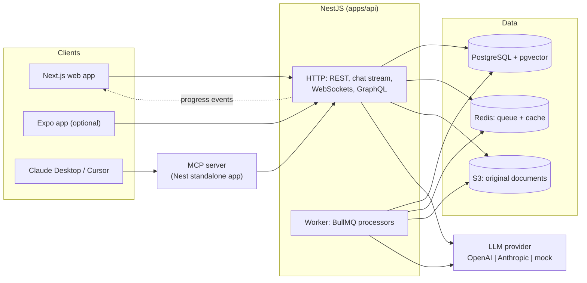

# DocPilot

DocPilot answers questions about your documentation with cited sources, and can
act on it through tools and MCP.

[](./.github/workflows/ci.yml)
[](./LICENSE)
[](./packages/tsconfig/base.json)

> Live demo: _coming soon_

<!-- TODO(docs): replace with a recording of upload, question, streamed cited answer. -->


## Why this exists

Most document assistants answer confidently and leave you to check whether the
answer is in the documents at all. DocPilot's answers carry a citation for every
claim, pointing at the exact passage it came from, so the answer can be verified
in one click rather than taken on trust.

## Features

- **Answers with citations.** Every claim links to the chunk it came from:
  document, heading path, page number, snippet.
- **Hybrid retrieval.** Vector similarity and full-text search fused with
  Reciprocal Rank Fusion, so an exact function name is found as reliably as a
  paraphrased question.
- **Streaming chat.** Tokens appear as they are produced, with stop and retry.
- **Live ingestion progress.** Upload status streams over WebSockets rather than
  being polled.
- **A tool-calling agent** with step limits and explicit approval before any
  side effect.
- **Structured extraction** validated against Zod schemas, with a repair pass on
  invalid output.
- **An MCP server**, so Claude Desktop, Cursor or Claude Code can search the
  knowledge base from the editor.
- **REST and GraphQL**, sharing the same services and guardrails.
- **English and Brazilian Portuguese**, including language-aware text search.
- **Evals** measuring retrieval and answer quality, not just whether the code
  runs.
- **Guardrails**: rate limits, input and output caps, prompt-injection
  mitigations, and approval for side effects.
- **Cost tracking.** Every model call records its tokens and cost.

## Architecture



Everything server-side is NestJS, including the worker and the MCP server, and
the web app talks only to the API. The reasoning is in
[ADR 0011](./docs/adr/0011-nestjs-only-backend.md).

## Tech stack

| Layer           | Choice                                                                                  | Why                                                                                                                             |
| --------------- | --------------------------------------------------------------------------------------- | ------------------------------------------------------------------------------------------------------------------------------- |
| Monorepo        | pnpm workspaces + Turborepo                                                             | Shared contracts change with the code that uses them ([ADR 0001](./docs/adr/0001-monorepo-pnpm-turborepo.md))                   |
| Language        | TypeScript 6, `strict` plus `noUncheckedIndexedAccess` and `exactOptionalPropertyTypes` | The compiler catches what tests would otherwise have to                                                                         |
| Backend         | NestJS 12                                                                               | Modules, injection, guards and interceptors apply cross-cutting rules once ([ADR 0011](./docs/adr/0011-nestjs-only-backend.md)) |
| Database        | PostgreSQL 17 + pgvector 0.8                                                            | Relational data, full-text search and vectors in one store ([ADR 0003](./docs/adr/))                                            |
| ORM             | Drizzle                                                                                 | `vector` and `tsvector` are first-class, and the ranking SQL stays readable ([ADR 0002](./docs/adr/0002-orm-drizzle.md))        |
| Queue and cache | Redis + BullMQ                                                                          | Retries, backoff and progress for ingestion ([ADR 0007](./docs/adr/))                                                           |
| File storage    | S3 via the AWS SDK, LocalStack locally                                                  | The same code path runs locally and in production ([ADR 0008](./docs/adr/0008-s3-storage-with-localstack.md))                   |
| LLM             | Vercel AI SDK 7                                                                         | Provider-agnostic, with mock models for tests ([ADR 0004](./docs/adr/))                                                         |
| Web             | Next.js 16 App Router, React 19                                                         | Server components where they help, client state where it is needed                                                              |
| Web state       | Redux Toolkit + RTK Query                                                               | Typed, cached server state generated from the OpenAPI spec                                                                      |
| Styling         | Tailwind CSS 4                                                                          | Theme lives in CSS, which suits Server Components                                                                               |
| Design system   | `packages/ui` + Storybook 10                                                            | Every component state is documented and tested                                                                                  |
| i18n            | next-intl                                                                               | English and Brazilian Portuguese                                                                                                |
| Testing         | Jest, Vitest, Testing Library, Supertest, Testcontainers, Cypress, Playwright           | Each level answers a different question ([ADR 0010](./docs/adr/0010-test-strategy.md))                                          |
| CI              | GitHub Actions                                                                          | Every level runs on every pull request, with no secrets                                                                         |

Exact versions are recorded in [`docs/architecture.md`](./docs/architecture.md).

## Quick start

Requires **Node 26** (see [`.nvmrc`](./.nvmrc)), **pnpm 10** and **Docker**.

```bash
nvm use                 # or install Node 26 another way
pnpm install
cp .env.example .env
pnpm infra:up           # Postgres + pgvector, Redis, S3
pnpm db:migrate
pnpm dev                # API on :3001, web on :3000
```

Open <http://localhost:3000>. The API documents itself at
<http://localhost:3001/docs>.

Everything above works with **no API key**. A key is only needed to use a real
model instead of the deterministic mock; set `LLM_PROVIDER` and the matching key
in `.env`.

## Environment variables

Every variable is validated at startup, so a missing or malformed value stops
the process with a readable message rather than failing later on a request.
Variables are added as the code that reads them lands;
[`.env.example`](./.env.example) is always the complete list.

| Variable                                                            | Required    | Default                            | Purpose                                 |
| ------------------------------------------------------------------- | ----------- | ---------------------------------- | --------------------------------------- |
| `DATABASE_URL`                                                      | yes         | —                                  | Postgres connection                     |
| `REDIS_URL`                                                         | yes         | —                                  | Queue, cache and rate limiting          |
| `NODE_ENV`                                                          | no          | `development`                      | Runtime mode                            |
| `LOG_LEVEL`                                                         | no          | `info`                             | `fatal` to `trace`, or `silent`         |
| `API_PORT`                                                          | no          | `3001`                             | HTTP port                               |
| `CORS_ORIGIN`                                                       | no          | `http://localhost:3000`            | Allowed web origins, comma separated    |
| `WORKER_MODE`                                                       | no          | `inline`                           | `inline`, `separate` or `off`           |
| `WORKER_CONCURRENCY`                                                | no          | `2`                                | Parallel ingestion jobs                 |
| `STORAGE_DRIVER`                                                    | no          | `s3`                               | `s3` or `local`                         |
| `S3_BUCKET` / `S3_REGION`                                           | no          | `docpilot-documents` / `us-east-1` | Bucket and region                       |
| `S3_ENDPOINT`                                                       | no          | `http://localhost:4566`            | Empty targets real AWS                  |
| `S3_FORCE_PATH_STYLE`                                               | no          | `true`                             | Required by S3 emulators                |
| `AWS_ACCESS_KEY_ID` / `AWS_SECRET_ACCESS_KEY`                       | no          | `test` / `test`                    | Dummy values locally                    |
| `LLM_PROVIDER`                                                      | no          | `mock`                             | `openai`, `anthropic` or `mock`         |
| `OPENAI_API_KEY`                                                    | conditional | —                                  | Required when the provider is OpenAI    |
| `ANTHROPIC_API_KEY`                                                 | conditional | —                                  | Required when the provider is Anthropic |
| `FF_RERANK` / `FF_GRAPHQL` / `FF_AGENT_TOOLS` / `FF_PUBLIC_UPLOADS` | no          | `false` / `true` / `true` / `true` | Feature flag defaults                   |
| `DEMO_API_KEY`                                                      | no          | empty                              | Protects a public deployment            |
| `DD_TRACE_ENABLED`                                                  | no          | `false`                            | Datadog tracing, off without an agent   |
| `NEXT_PUBLIC_API_URL`                                               | yes (web)   | `http://localhost:3001`            | API base URL                            |

## Scripts

| Script                                 | What it does                         |
| -------------------------------------- | ------------------------------------ |
| `pnpm dev`                             | API and web in watch mode            |
| `pnpm build`                           | Build everything                     |
| `pnpm lint` / `pnpm typecheck`         | ESLint / `tsc --noEmit`              |
| `pnpm format` / `pnpm format:check`    | Prettier                             |
| `pnpm infra:up` / `pnpm infra:down`    | Start or stop Postgres, Redis and S3 |
| `pnpm infra:reset`                     | Recreate the containers from scratch |
| `pnpm db:generate` / `pnpm db:migrate` | Generate and apply migrations        |
| `pnpm openapi:export`                  | Regenerate `apps/api/openapi.json`   |
| `pnpm storybook`                       | Browse the design system             |
| `pnpm test`                            | Unit tests                           |
| `pnpm test:all`                        | Every test level, in CI order        |
| `pnpm test:coverage`                   | Unit tests with thresholds enforced  |

[`docs/testing.md`](./docs/testing.md) lists the per-level commands.

## Project structure

```
apps/
  api/          NestJS: HTTP API and the ingestion worker
  web/          Next.js App Router application
packages/
  shared/       Zod schemas and types shared across every surface
  ui/           Design system and Storybook
  testing/      Factories and deterministic model doubles
  tsconfig/     Shared compiler options
  eslint-config/
docs/
  adr/          One decision record per significant choice
  specs/        One spec per feature, written before the code
```

## How it works

Documents are uploaded, stored in S3, and queued for ingestion. A worker parses
them, splits them into overlapping chunks that respect headings and code blocks,
embeds the chunks in batches, and stores them with their embeddings and a
text-search vector.

A question is embedded and run through two searches at once: vector similarity
over the embeddings, and full-text search over the text vectors. The two ranked
lists are fused, and the best chunks become numbered context in a prompt that
instructs the model to cite them and to say it does not know when the context is
insufficient. Citation markers in the answer are mapped back to chunks, and
invalid ones are dropped rather than shown.

The agent wraps the same retrieval in a tool-calling loop with a step limit, and
anything with a side effect asks for confirmation first.

Details: [`docs/rag-pipeline.md`](./docs/rag-pipeline.md),
[`docs/agent-and-tools.md`](./docs/agent-and-tools.md),
[`docs/architecture.md`](./docs/architecture.md).

## Development workflow and testing

Every feature follows one loop: **spec, failing test, implementation, refactor,
docs**. The spec is committed first, with numbered acceptance criteria, and each
criterion's number appears in the name of the test that proves it, so
`grep -r AC3` finds it.

| Level              | Tool                               | Command                                      |
| ------------------ | ---------------------------------- | -------------------------------------------- |
| Unit               | Jest (backend), Vitest (front end) | `pnpm test`                                  |
| Integration        | Jest + Testcontainers              | `pnpm test:integration`                      |
| API end-to-end     | Jest + Supertest                   | `pnpm test:api-e2e`                          |
| Contract           | Jest + Ajv against `openapi.json`  | `pnpm test:contract`                         |
| Component          | Cypress, Storybook in Chromium     | `pnpm test:component`, `pnpm test:storybook` |
| Browser end-to-end | Playwright                         | `pnpm test:e2e`                              |

The whole suite runs with **no API keys**: every model call goes through a
deterministic mock wired in through the same provider factory production uses.
See [`docs/testing.md`](./docs/testing.md).

## Evals

Retrieval and answer quality are measured against a golden set rather than
assumed. Results land here from M7; see [`docs/evals.md`](./docs/evals.md).

## Status and roadmap

| Milestone                                    | Status  |
| -------------------------------------------- | ------- |
| M0 Scaffolding, tooling, test infrastructure | done    |
| M1 Ingestion                                 | next    |
| M2 Retrieval and cited answers               | planned |
| M3 Streaming chat UI                         | planned |
| M4 Tool-calling agent                        | planned |
| M5 Structured extraction                     | planned |
| M6 MCP server                                | planned |
| M7 Evals, guardrails, cost and tracing       | planned |
| M8 GraphQL read API                          | planned |
| M9 Deployment                                | planned |

## Known limitations

- No OCR: a scanned PDF with no text layer yields nothing.
- Single workspace. There is no per-user isolation, so it is not multi-tenant.
- `create_ticket` writes to a local table; it integrates with no real tracker.
- Answer quality depends on the documents. Nothing in the corpus means an honest
  "I don't know", which is the intended behaviour rather than a fallback to the
  model's own knowledge.
- The LocalStack image is pinned to the last release that runs without a paid
  token; see [ADR 0008](./docs/adr/0008-s3-storage-with-localstack.md).

## License

[MIT](./LICENSE) © Arthur Cavini —
[LinkedIn](https://www.linkedin.com/in/cavini)
