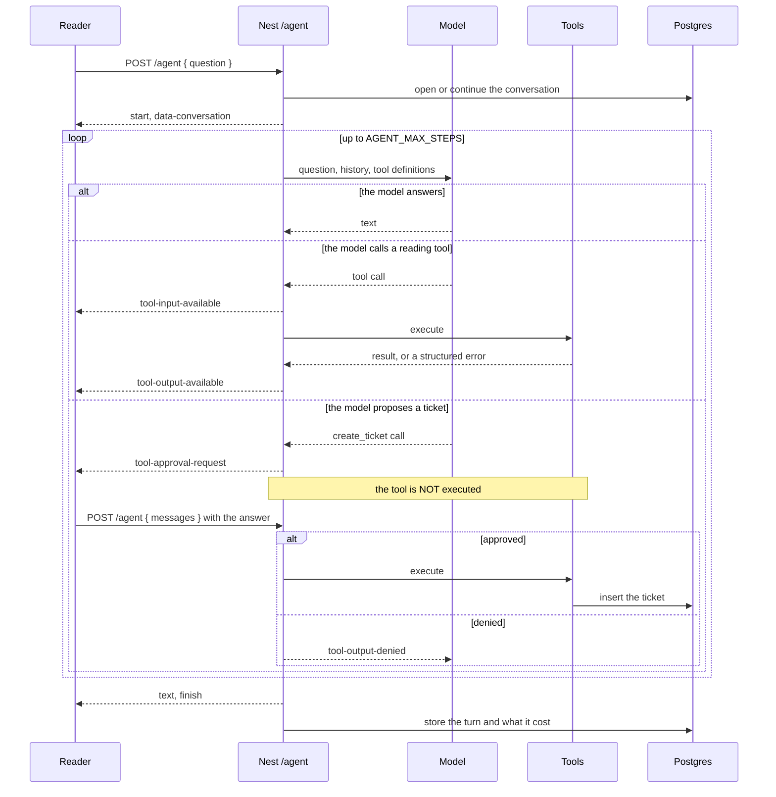

# The agent and its tools

How `/agent` differs from `/chat`, what the model may do, and what it may not do
without being asked.

## Why an agent at all

`/chat` retrieves once, with the reader's own words, and answers from what comes
back. That is the right shape for most questions and the wrong one for three:

| Question                      | Why retrieval alone fails                                                                    |
| ----------------------------- | -------------------------------------------------------------------------------------------- |
| "Summarise the billing guide" | Search returns the eight passages most like the question; a summary needs the whole document |
| "List every endpoint as JSON" | Prose is the wrong output, and a model asked for JSON produces something that usually parses |
| "Open a ticket for this"      | It is an action, not an answer                                                               |

So the model gets tools and chooses. What that costs is predictability, which is
why the loop is bounded and watched.

## The loop

## The four tools

| Tool                 | Reads               | Writes   | Spec                                       |
| -------------------- | ------------------- | -------- | ------------------------------------------ |
| `search_docs`        | The corpus          | —        | [spec](./specs/tool-search-docs.md)        |
| `summarize_document` | One document, whole | —        | [spec](./specs/tool-summarize-document.md) |
| `extract_structured` | Retrieved passages  | —        | [spec](./specs/tool-extract-structured.md) |
| `create_ticket`      | —                   | A ticket | [spec](./specs/tool-create-ticket.md)      |

### `search_docs`

The hybrid search `/search` already runs, handed to the model so it can look
again with better terms after reading what the first search returned. That is
the thing `/chat` cannot do: "how do I authenticate" might become "bearer token
expiry" on a second pass.

### `summarize_document`

Map-reduce. A long document does not fit in one prompt, and truncating it to fit
produces a summary of the first third that claims to be a summary of the
document.

The `focus` goes into **every map prompt**, not only the reduce. By the time the
reduce runs, the detail a focus would have selected for has already been
discarded — focusing at the end selects among summaries of the wrong things.

A document above `SUMMARY_MAX_CHUNKS` is refused, with its size named, rather
than silently costing dozens of model calls.

### `extract_structured`

The model names a schema the **server** knows rather than supplying one. A
model-supplied schema is a model-supplied contract: nothing downstream could
rely on it, and it would be a way to make the server produce arbitrary shapes on
request. An unknown name comes back with the list of known ones, so the next
attempt can succeed rather than being another guess.

Validated twice. The SDK constrains the provider and rejects a response that
does not match at all; that rejection is caught and returned as a structured
failure so the model can narrow its query. Then every item is checked here too,
because providers differ in how strictly they enforce a schema and an
almost-right item passed through surfaces as a runtime error somewhere else
entirely. A single bad item is dropped and counted — one bad endpoint among ten
good ones is still nine endpoints.

### `create_ticket`

The tracker is a **mock**. The approval is not, and it is the part that would
have to be right if the tracker were real.

## Three guarantees

### Tool errors are data, not exceptions

Every tool returns `{ ok: false, code, message }` rather than throwing. A thrown
error ends the turn with nothing; a returned one is something the model can act
on — retry with different arguments, or tell the reader it could not.

The timeout produces the same shape, so the model handles one kind of failure
rather than two. It bounds how long the **loop waits** rather than cancelling
the work, which is usually a query or a provider call that will finish and be
discarded — the waiting is the part that matters, since the reader and the
provider's meter are both still running.

A bug inside a tool is rethrown rather than reported as a timeout, which would
send the model off retrying something that will never work.

### The step limit is not optional

`AGENT_MAX_STEPS` (six) bounds the model calls in one turn. A model that keeps
calling tools — because one keeps failing, or because it has misunderstood —
costs money on every step and would otherwise run until the request times out.

A turn that uses every step without answering stores a notice saying so rather
than an empty message, which would read as the product being broken instead of
as the agent giving up.

Testing this needs a model that calls tools for ever, which is exactly what a
real one cannot be relied on to do. The scripted mock is told to.

### Nothing irreversible happens unasked

**The loop enforces approval, not the tool.** Nothing in `create_ticket` checks
for it: a tool that policed its own approval could be bypassed by any caller
that forgot to, where a loop that will not call it cannot be.

Approval is configured on the `streamText` call — the SDK deprecated the
tool-level flag — and the loop simply does not execute the tool until the client
answers.

The tests assert this where it cannot be faked:

| Claim                                | How it is proved                   |
| ------------------------------------ | ---------------------------------- |
| Proposing creates nothing            | API e2e, by counting rows          |
| An unanswered stream creates nothing | API e2e, by counting rows          |
| A denial reaches the server          | Browser e2e, by recording requests |
| The proposal is shown in full        | Browser e2e, by reading the page   |

Counting rows rather than reading the model's reply is the point: the model's
account of what happened is not evidence.

## Resuming after an approval

This is the one place the client sends more than a question, and it is worth
saying why.

The AI SDK carries the reader's answer **inside the message parts**. There is
nowhere else to put it, so answering an approval means sending the turn so far
back to the server, which replays it with `convertToModelMessages` and continues
from where it paused.

Those messages are used **only** to resume the in-flight turn. The
conversation's history still comes from the server's store, so a client cannot
rewrite what was said by editing them — the worst it can do is mis-resume its
own turn.

Two things about this were not obvious and both cost real debugging:

- `addToolApprovalResponse` only records the answer in the client's message
  state. Without `sendAutomaticallyWhen` nothing is posted and the model waits
  for ever — which looked like a dialog that accepted a click and did nothing.
- The request body is rewritten to `{ question, conversationId }`, which was
  dropping exactly the messages the server needed.

## Running it with no API key

`LLM_PROVIDER=mock` scripts the agent to call `search_docs` once and then
answer. The tool step is real and the search it runs is the real hybrid
retrieval; only the _decision_ to search is scripted.

Without that the mock answers directly every time and `/agent` looks identical
to `/chat`, which would hide the one thing this milestone added.

## What this does not do

- **Parallel tool calls.** One at a time keeps the transcript readable, and
  nothing here benefits from concurrency.
- **Tools that reach outside the application.** `create_ticket` is a mock, and
  nothing calls the network.
- **Planning, reflection or sub-agents.** The loop is call-a-tool-and-look.
- **Editing a proposal before approving it.** Deny and ask again.
- **A token budget instead of a step limit.** Steps are predictable and easy to
  explain; a budget is what actually bounds cost. Which is right is an M7
  measurement rather than a guess — see
  [`specs/agent-loop.md`](./specs/agent-loop.md#open-questions).
