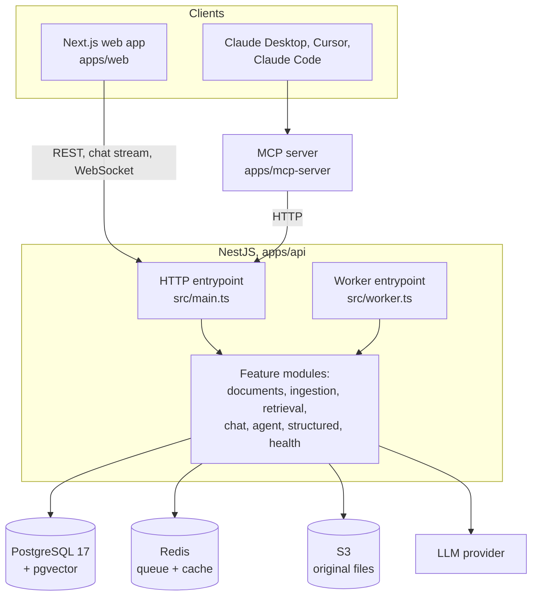

# Architecture

What the pieces are, why they are separate, and which versions they are.

## Components



Everything server-side is NestJS, including the worker and the MCP server, and
`apps/web` holds no business logic, no database driver and no model SDK. The
reasoning, and what that rules out, is in
[ADR 0011](./adr/0011-nestjs-only-backend.md).

### Why the worker is a second entrypoint, not a second project

`src/worker.ts` boots the same `AppModule` through
`NestFactory.createApplicationContext`, so it has no HTTP listener but every
provider the API has. `WORKER_MODE` decides where the processors run:

- `inline` keeps them in the API process. One service to deploy, which is what
  the demo runs on.
- `separate` runs this entrypoint as its own process, so ingestion load cannot
  slow request handling.
- `off` disables processing, which the tests use.

Scaling out is a configuration change, not a rewrite.

## Module map (`apps/api/src`)

| Module          | Responsibility                                                                                   |
| --------------- | ------------------------------------------------------------------------------------------------ |
| `config`        | Parses and validates the environment once, before Nest starts, and provides it as a typed object |
| `common`        | Typed domain errors, the global exception filter, shared HTTP shapes                             |
| `db`            | The connection pool and the Drizzle query builder, closed on shutdown                            |
| `redis`         | The shared Redis client                                                                          |
| `storage`       | The S3 client and the storage probe                                                              |
| `health`        | `GET /health` and `GET /health/live`                                                             |
| `feature-flags` | Which capabilities are on                                                                        |
| `observability` | pino configuration and the env-gated tracer                                                      |

Modules arriving with later milestones: `documents`, `ingestion`, `retrieval`,
`chat`, `agent`, `structured`, `graphql`, `guardrails`.

## Configuration

The environment is parsed by `loadEnv()` **before** the Nest application is
created, and provided under the `ENV` token as a typed object. A provider that
needs configuration declares `Env` as a dependency and gets a fully typed value,
so a typo in a variable name is a compile error rather than an `undefined`
discovered at runtime.

A missing or malformed variable stops the process immediately, with **every**
problem listed at once. A deployment with three mistakes takes one restart to
diagnose rather than three.

Variables are added to the schema in the milestone that starts reading them, so
the schema, `.env.example` and the README never describe settings that no code
honours.

## Errors

Every failure leaves the API in one shape:

```json
{
  "error": {
    "code": "not_found",
    "message": "document 7f3a was not found",
    "requestId": "9f2c1e84-0b2b-4f0e-9d3e-7a1f2c6b8d14"
  }
}
```

Clients branch on `code`, which is stable; `message` is for humans and may be
reworded. Three cases are handled differently on purpose:

- A **domain error** is expected. Its code, status and safe details are
  returned, and it is logged at `warn`.
- A **Nest `HttpException`**, usually from DTO validation, keeps its status and
  derives its code from the status name.
- **Anything else is a bug.** The client gets a generic `internal_error` with no
  detail, because an unexpected error's message can contain a connection string;
  the full error and stack go to the log at `error`.

## Logging

Structured JSON through pino, with a request id on every line. An inbound
`x-request-id` is reused so a trace survives the hop from the web app, and the
id is echoed in the response header and in error bodies, so a user-visible
failure can be traced to its log lines.

Credential-bearing headers are redacted before anything is written. Health
probes are excluded from request logging, because at one probe every few seconds
they would otherwise be most of the log.

## Health

`GET /health` probes Postgres, Redis and storage **concurrently**, each under
its own timeout, and answers 503 if any is down. The body always names which one
and why, so a load balancer can act on the status code while a human gets the
diagnosis.

`GET /health/live` deliberately probes nothing. Restarting a process helps when
the process is wedged and does nothing when Postgres is down; probing
dependencies from a liveness check turns one outage into a restart loop across
every replica.

## API contract

`@nestjs/swagger` serves the documentation at `/docs` and `pnpm openapi:export`
writes `apps/api/openapi.json` from the same definition. That file is committed
and CI regenerates and diffs it, so an undocumented endpoint or a changed
response shape is a build failure rather than something a client discovers
later. The typed clients for the web app and the MCP server are generated from
it.

The export builds the application graph but never listens, and no provider opens
a connection until it is used, so it runs with no database, Redis or storage —
which is what lets it live in the cheap static stage of CI.

## Versions

Chosen by checking the registry rather than from memory, and recorded here so a
future reader knows what this was built against.

| Package         | Version    | Notes                                  |
| --------------- | ---------- | -------------------------------------- |
| Node            | `26.13.0`  | runtime, pinned in .nvmrc and engines  |
| pnpm            | `10.11.0`  | package manager                        |
| TypeScript      | `6.0.3`    | the ceiling typescript-eslint supports |
| Turborepo       | `2.11.10`  | task orchestration and caching         |
| ESLint          | `10.14.0`  | with typescript-eslint 8.72.1          |
| Prettier        | `3.9.10`   | formatting                             |
| NestJS          | `12.3.2`   | API and worker                         |
| Drizzle ORM     | `0.45.4`   | with drizzle-kit 0.31.11               |
| node-postgres   | `8.23.1`   | Postgres driver                        |
| ioredis         | `6.0.0`    | Redis client                           |
| AWS SDK (S3)    | `3.1161.0` | document storage                       |
| pino            | `10.4.0`   | with nestjs-pino 5.3.1                 |
| Zod             | `4.6.7`    | env, contracts, tool and model I/O     |
| Jest            | `30.5.2`   | with @swc/jest 0.2.39                  |
| Testcontainers  | `12.2.1`   | real services in integration tests     |
| Supertest       | `7.3.1`    | API end-to-end                         |
| Ajv             | `8.20.0`   | contract validation                    |
| Next.js         | `16.4.3`   | App Router                             |
| React           | `19.3.1`   |                                        |
| Redux Toolkit   | `2.13.0`   | with react-redux 9.3.1                 |
| next-intl       | `4.14.9`   | en and pt-BR                           |
| Tailwind CSS    | `4.3.3`    | theme defined in CSS                   |
| Vitest          | `5.0.5`    | front end and packages                 |
| Testing Library | `16.3.3`   |                                        |
| Cypress         | `16.2.1`   | component testing                      |
| Playwright      | `1.64.1`   | browser journeys                       |
| Storybook       | `10.6.5`   | with @storybook/addon-vitest           |
| AI SDK          | `7.0.158`  | provider-agnostic model access         |

### Why not the newest of everything

- **TypeScript 6, not 7.** `typescript-eslint` supports `<6.1.0`, and
  `@nestjs/cli` pins `~6.0.2`. Taking TypeScript 7 would cost type-aware linting
  across the whole repository, which is a worse trade than waiting.
- **Postgres 17, not 18.** 17 is what the managed hosts used in production
  offer, so local and deployed behaviour match.
- **LocalStack 4.14.0, not the current release.** Later releases refuse to start
  without a paid auth token. See
  [ADR 0008](./adr/0008-s3-storage-with-localstack.md).

### Two findings worth knowing

**Nest 12 is ESM-only.** `@nestjs/common` is published as `"type": "module"`
with no CommonJS build. Node loads it from CommonJS through `require(esm)`, but
Jest explicitly reports that feature as unavailable inside its sandbox, so the
backend suites run with `--experimental-vm-modules`. The Nest 12 starter does
the same.

**`next/root-params` is untyped in practice.** Next generates typed declarations
for it into `.next/types`, and also ships `declare module 'next/root-params'` in
the package. The shorthand wins, so every import from it is `any` whether or not
the generated types exist. That `any` is narrowed once, in
`apps/web/src/i18n/root-params.ts`.

## Sequence diagrams

Ingestion, the RAG query path, the agent loop and the MCP call path are added
with the milestones that implement them (M1 to M6).
