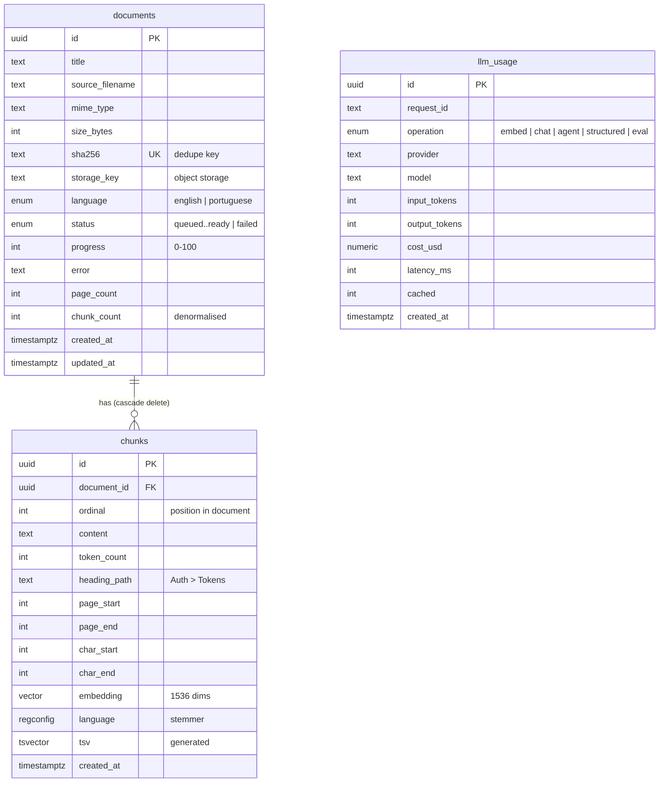

# The data model

Every table, what each column is for, and why each index exists.

## Diagram



`llm_usage` has no foreign keys on purpose. It is an append-only ledger, and a
cost record must survive the deletion of whatever caused it; otherwise deleting
a document would quietly rewrite history.

## `documents`

One row per uploaded file.

| Column               | Why                                                                                                                                                                                                                                                             |
| -------------------- | --------------------------------------------------------------------------------------------------------------------------------------------------------------------------------------------------------------------------------------------------------------- |
| `sha256`             | Deduplication. The same bytes uploaded twice are one document, whatever the file was named, because the content is what gets embedded. **Unique**, so two concurrent uploads of the same file cannot both create a row — the second insert fails and is caught. |
| `storage_key`        | Where the original lives. Derived from the document id, never from the uploaded filename, so a crafted name cannot escape its prefix.                                                                                                                           |
| `status`, `progress` | The durable, user-facing projection of ingestion. Redis holds the queue's own truth about retries; a user looking at a document should not need the queue running to find out what happened to it.                                                              |
| `error`              | Why it failed, in words. Never contains credentials.                                                                                                                                                                                                            |
| `chunk_count`        | Denormalised. The document list shows it for every row, and counting chunks per document on each request is the kind of query that looks free until the corpus grows.                                                                                           |
| `language`           | Which stemmer its chunks are indexed with.                                                                                                                                                                                                                      |

### Indexes

- `documents_sha256_idx` (unique) — enforces deduplication and makes the lookup
  on upload a single index probe.
- `documents_created_at_idx` on `created_at DESC` — the listing is newest-first,
  so the index matches the sort and the query avoids a sort step entirely.
- `documents_status_idx` — the worker asks for queued work.

## `chunks`

One row per retrievable passage. This is the table retrieval actually reads.

| Column                   | Why                                                                                                                                                                                                  |
| ------------------------ | ---------------------------------------------------------------------------------------------------------------------------------------------------------------------------------------------------- |
| `ordinal`                | Position in the document. Unique with `document_id`, so a re-ingestion bug shows up as a constraint violation rather than as silently duplicated passages.                                           |
| `heading_path`           | `"Auth > Tokens > Refresh"`. Shown with a citation so a reader knows where in the document they have landed.                                                                                         |
| `page_start`, `page_end` | For PDFs, so a citation can name a page. Null for formats without pages.                                                                                                                             |
| `char_start`, `char_end` | Offsets into the extracted text, for highlighting the exact passage.                                                                                                                                 |
| `embedding`              | `vector(1536)`. The width is fixed in the schema because the index is built for it; changing the embedding model is a migration plus a re-embedding of the whole corpus, not a configuration change. |
| `language`               | `regconfig`, copied from the document. Denormalised because a generated column can only read its own row.                                                                                            |
| `tsv`                    | Lexemes for keyword search, **generated by Postgres**.                                                                                                                                               |

### Why `tsv` is generated, and why `language` is a `regconfig`

The obvious schema is `language text` plus
`to_tsvector(language::regconfig, content)`. Postgres rejects it:

```
ERROR:  generation expression is not immutable
```

Casting text to `regconfig` is only _stable_ — it reads the catalog — and a
generated column's expression must be immutable. Declaring the column as
`regconfig` makes the two-argument `to_tsvector` immutable and the expression
legal:

```sql
"language" regconfig DEFAULT 'english' NOT NULL,
"tsv" tsvector GENERATED ALWAYS AS (to_tsvector(language, content)) STORED
```

Generated rather than written by the application, so `tsv` cannot drift from
`content`: there is no code path that updates one and forgets the other.

The stemmer matters more than it looks. The same text indexed under each
configuration:

| Text                                      | Config       | Lexemes                            |
| ----------------------------------------- | ------------ | ---------------------------------- |
| `The tokens are refreshing quickly`       | `english`    | `'quick':5 'refresh':4 'token':2`  |
| `Os tokens estão atualizando rapidamente` | `portuguese` | `'atualiz':4 'rapid':5 'tokens':2` |

Searching `atualizar` matches `atualiz` under the Portuguese stemmer and misses
entirely under the English one. Indexing a Portuguese corpus with the English
configuration silently halves keyword recall, and nothing announces it.

`documents.language` is an enum while `chunks.language` is a `regconfig`. The
enum is the validated domain value, constrained to languages the project
supports; the `regconfig` exists because the generated column requires it.

### Replacing a generated column takes its index

This cost a real bug. Migration `0002` folded the heading path into `tsv`, and
the only way to change a generated column's expression is to drop and re-add it:

```sql
ALTER TABLE "chunks" drop column "tsv";
ALTER TABLE "chunks" ADD COLUMN "tsv" "tsvector" GENERATED ALWAYS AS (…) STORED;
```

`DROP COLUMN` takes every index that depends on the column with it, so
`chunks_tsv_idx` went with it and was never recreated. Keyword search became a
sequential scan over every chunk and stayed correct, so nothing failed — it just
stopped being indexed.

`drizzle-kit generate` cannot catch this. Its snapshot still recorded the index
as present, because the drop was a _column_ change rather than an _index_
change, so diffing the schema against the snapshot reported nothing to do.
Migration `0003` recreates it by hand.

What catches it now is a test that asserts the query plan, in
`test/integration/retrieval.spec.ts`. A missing index changes nothing about the
rows returned, so it is invisible to every test that only checks results.

### Indexes

- `chunks_document_ordinal_idx` (unique) — reads a document's chunks in order,
  and enforces the invariant above.
- `chunks_embedding_hnsw_idx` — HNSW with `vector_cosine_ops`, `m = 16`,
  `ef_construction = 64`. Only `<=>` can use it; see
  [`rag-pipeline.md`](./rag-pipeline.md#two-searches-one-ranking).
- `chunks_tsv_idx` — GIN, the right index for a `tsvector`. Usable only when the
  `tsquery` on the right-hand side is constant across rows, which shapes how the
  keyword search is written.

### HNSW rather than IVFFlat

Both are approximate nearest-neighbour indexes in pgvector.

**IVFFlat** partitions vectors into lists and searches the nearest few. It
builds fast and uses little memory, but it has to be _trained_ on existing data:
an index built on an empty or small table partitions badly, and recall degrades
as the corpus grows away from what it was trained on. For a corpus that grows
one upload at a time, that means periodic rebuilds.

**HNSW** builds a layered graph of neighbours. It needs no training step, holds
its recall as rows are added, and is faster to query. The costs are a slower
build and more memory.

For this project — a corpus that grows incrementally, and where a rebuild step
nobody remembers to run is a bug waiting to happen — HNSW is the right default.
`m = 16` and `ef_construction = 64` are pgvector's defaults; tuning them against
measured recall belongs in the eval work, not in a guess made now.

### Cosine distance

The `<=>` operator, matching `vector_cosine_ops` on the index. Cosine compares
_direction_ rather than magnitude, so a long passage does not outrank a short
one merely for being long. Embeddings are stored as the provider returns them;
the deterministic test model normalises to unit length for the same reason.

## `llm_usage`

One row per call to a model provider, including calls that fail.

`cost_usd` is `numeric(12,6)` rather than a float because these values are
summed, and summing floats drifts. Six decimal places covers a fraction of a
cent per call.

Indexed on `created_at` and `operation`, which are what the usage summary groups
by.

## Migrations

Generated by Drizzle Kit from the schema in `apps/api/src/db/schema/`, written
to `apps/api/drizzle/`, and committed as plain SQL so a reviewer can see exactly
what will run.

```bash
pnpm db:generate   # after changing the schema
pnpm db:migrate    # apply
```

The first migration enables the `vector` extension, which has to exist before
any column can declare a vector type. A fresh database therefore reaches a
working state through `pnpm db:migrate` alone, with no setup step a reader has
to know about.

Generated SQL is reviewed before being committed. Drizzle Kit is less
opinionated than some tools about destructive changes, so a diff that drops a
column is something to notice rather than trust.
