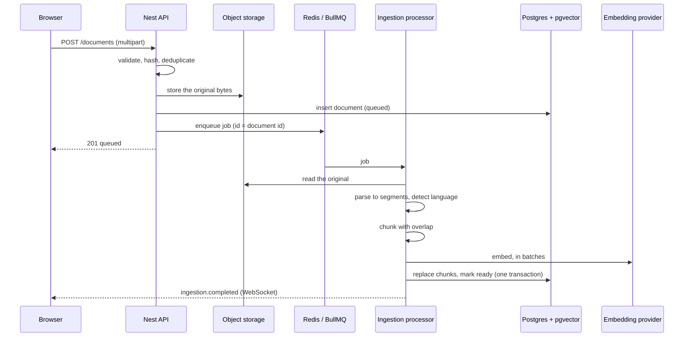

# The RAG pipeline

How a document becomes something a question can be answered from.

This page covers **ingestion** — parsing, chunking, embedding and storage.
Retrieval and answering are added in M2.

## Overview



## Upload

A file is validated before anything is stored:

- **Type.** The declared `Content-Type` is a claim by the client, and browsers
  are inconsistent about it — a `.md` file routinely arrives as
  `application/octet-stream`. The file's own signature is checked first, the
  extension second, the declared type last. A file named `.pdf` whose bytes are
  not a PDF is rejected rather than read.
- **Size**, against `MAX_UPLOAD_MB`.
- **Emptiness.** A zero-byte document would reach `ready` with no chunks and
  answer nothing, which looks like a bug rather than a rejected upload.

### Deduplication

The SHA-256 of the **content** is the deduplication key, with a unique index
behind it. The same bytes uploaded under two names are one document, because the
content is what gets embedded.

Re-uploading returns **200** with the existing document rather than 409, which
makes upload idempotent: a client that retries after a timeout, or a user who
drags the same file in twice, simply uses what comes back. A document that
previously _failed_ is the exception — it is reprocessed, because the failure
may have been transient.

### Order of operations

The object is stored **before** the row is inserted. The reverse order leaves a
row pointing at bytes that were never written, which can never succeed. This way
a failure leaves an orphaned object, which is deleted on the error path and is
harmless if that cleanup also fails.

The storage key is derived from the document id, never from the uploaded
filename, so a name like `../../etc/passwd` cannot escape its prefix.

## Parsing

Every format reduces to the same shape — a list of segments with character
offsets, plus page spans where the format has pages — so the chunker never
learns what a PDF is.

| Format     | Reader                      | Notes                                          |
| ---------- | --------------------------- | ---------------------------------------------- |
| PDF        | `unpdf` (bundled pdf.js)    | Extracted **page by page**, then joined        |
| Markdown   | A block parser written here | Headings, fenced code, paragraphs              |
| Plain text | The same block parser       | A `.txt` using `#` headings gets the structure |

### Why PDFs are extracted page by page

The page boundaries are the only way a chunk can later say "page 7" in a
citation. Extracting the document as one string and reconstructing where pages
began is guesswork, so pages are extracted separately and joined with known
offsets.

### Why the Markdown parser is written rather than imported

A full Markdown parser produces an abstract syntax tree with no reliable
character offsets back into the source, and those offsets are what let a
citation highlight the exact passage. The block parser handles the three things
chunking actually needs — heading levels, fenced code boundaries, and blank-line
separated blocks. Lists, tables and blockquotes come through as paragraph-like
blocks, which is the right treatment for chunking: they are prose to retrieve,
not structure to navigate.

### Language detection

A frequency count over function words, plus accented characters as evidence. Not
a statistical model: it only has to separate two languages, it must be
deterministic so the same document always lands in the same configuration, and
it must run on every ingestion without a dependency or a model call.

Getting it wrong is quiet rather than loud — Portuguese indexed with the English
stemmer still stores and still retrieves by vector, it just loses keyword
recall. So the default leans English, which is what a technical corpus mostly
is.

## Chunking

Covered in full by [ADR 0005](./adr/0005-chunking-strategy.md). In short: split
at the strongest structural boundary available, 500 tokens with 75 of overlap,
code blocks kept whole where they fit, and the heading path travels with the
chunk into both the embedding and the keyword index.

Sizes are in **tokens**, not characters, because that is what models charge and
limit by. The same 43 characters can be 6 tokens or 9.

## Embedding

Chunks are embedded in **batches** through the AI SDK's `embedMany`, which
splits the input to the provider's own batch limit. One request per chunk would
make a hundred-page document a hundred round trips, and providers price and rate
limit per request as well as per token.

A failed batch is retried three times with exponential backoff. The failures
that matter here are transient — a rate limit, a timeout, a provider blip. A
malformed request fails identically every time and simply exhausts the attempts,
which is the right outcome: the job then fails with the provider's own message
rather than looping.

### Which model, and why it is configured separately

`text-embedding-3-small` by default: 1536 dimensions, $0.02 per million tokens,
and good enough that the retrieval bottleneck is chunking rather than the model.
`text-embedding-3-large` is 3072 dimensions at $0.13 — six and a half times the
price for a modest gain on this kind of corpus, and it would double the index
size.

**`EMBEDDING_PROVIDER` is separate from `LLM_PROVIDER`** because Anthropic
publishes no first-party embeddings API. Choosing Claude to answer questions
does not choose anything about embeddings, so the two are independent settings
rather than one.

### Every call is recorded

Each batch writes a row to `llm_usage` with the model, token count, computed
cost and latency, so "what did this cost" is a question the database answers
rather than a provider dashboard.

## Storage

Chunks are written inside **one transaction** that first deletes the document's
existing chunks:

```ts
await db.transaction(async (tx) => {
  await tx.delete(chunks).where(eq(chunks.documentId, id));
  await tx.insert(chunks).values(rows);
  await tx.update(documents).set({ status: 'ready', chunkCount: rows.length });
});
```

That makes re-ingestion idempotent and makes a crash safe: there is no moment
where a document is marked `ready` with half its passages.

The schema, its indexes, and why the `tsvector` is a generated column are in
[`data-model.md`](./data-model.md).

## Failure handling

| What happened                  | What the user sees                                     |
| ------------------------------ | ------------------------------------------------------ |
| Provider timeout or rate limit | Retried with backoff; usually invisible                |
| Attempts exhausted             | `failed`, with a readable reason, and a retry endpoint |
| Not a readable PDF             | `failed` immediately — retrying cannot help            |
| PDF with no text layer         | `failed`, naming OCR as the reason                     |
| Document deleted while queued  | The job exits quietly                                  |

An unreadable file is failed on the **first** attempt rather than after three:
it would fail identically every time, and retrying only delays the answer
someone is waiting for.

## What this does not do

- **OCR.** A scan with no text layer produces nothing and is failed with that
  said plainly.
- **PDF heading detection.** A PDF signals headings by font size, which the
  parser does not read, so PDF chunks carry page numbers instead of heading
  paths. Markdown gets both.
- **Table structure.** A table is chunked as lines; its columns are lost.
- **Incremental re-ingestion.** A changed document is reprocessed whole.

## What would change at scale

**A much larger corpus.** HNSW build time and memory grow with the row count.
The first move is tuning `m` and `ef_construction` against measured recall
rather than accepting the defaults; after that, partitioning by document set.

**Changing the embedding model.** The vector column has a declared width and an
index built for it, so this is a migration plus a re-embedding of everything —
not a configuration change. Done properly it is a second column, a backfill, and
a cutover, so retrieval keeps working throughout. The schema makes the cost
visible rather than hiding it behind a setting.

**Multi-tenant.** Every retrieval query would need a tenant predicate, and the
index would need to include it, or one tenant's query would pay for every other
tenant's vectors.

**Ingestion throughput.** `WORKER_MODE=separate` already moves processors to
their own process; beyond that it is more worker processes and a higher
`WORKER_CONCURRENCY`, bounded by the provider's rate limit rather than by CPU.
