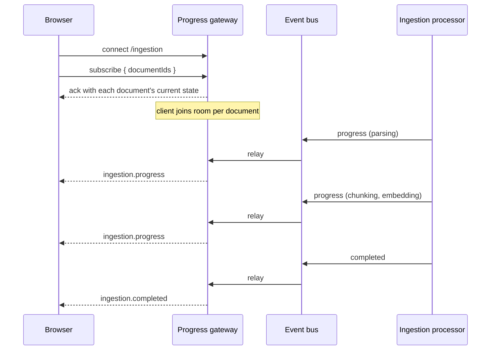

# Real-time updates

How ingestion progress reaches the browser without polling.

The reasoning behind using WebSockets at all is in
[ADR 0012](./adr/0012-websockets-for-progress.md); this page is how it works.

## The path an event takes



The processor never talks to a socket. It publishes to an event bus and the
gateway listens, which is what lets the worker run in a different process from
the one holding the connections.

## Connecting

Namespace `/ingestion`:

```ts
import { io } from 'socket.io-client';

const socket = io(`${process.env.NEXT_PUBLIC_WS_URL}/ingestion`);
```

## Subscribing

```ts
socket.emit('subscribe', { documentIds: [id] }, (ack) => {
  if (!ack.ok) {
    // Malformed request; the connection stays open.
    return;
  }
});
```

The acknowledgement carries each document's current state. That matters more
than it looks: ingestion often finishes before a browser finishes connecting,
and without the current state in the acknowledgement the interface would wait
forever for an event that already happened.

At most **50** documents per client. Without a cap, one client could subscribe
to the whole corpus and be woken by all of it.

## Events

| Event                 | Payload                                                            |
| --------------------- | ------------------------------------------------------------------ |
| `ingestion.progress`  | `{ documentId, status, progress }`                                 |
| `ingestion.completed` | `{ documentId, status: 'ready', chunkCount, pageCount, language }` |
| `ingestion.failed`    | `{ documentId, status: 'failed', error }`                          |

`ingestion.completed` carries **everything ingestion determined**, not only what
changed since the last progress tick. It is the client's last word on the
document, so a field left out of it leaves the reader looking at a row with a
hole in it until something unrelated happens to refetch — which is exactly what
happened with `language` before it was added here.

`status` is the pipeline stage: `parsing`, `chunking`, `embedding`. `progress`
is a percentage.

### Why progress is a fixed number per stage

The stages take wildly different amounts of time — parsing a Markdown file is
instant, embedding a hundred chunks is not. A bar driven by "fraction of chunks
embedded" races to 90% and then sits there, which reads as stuck. Fixed points
per stage move in steps a user can understand:

| Stage       | Progress |
| ----------- | -------- |
| `parsing`   | 10       |
| `chunking`  | 35       |
| `embedding` | 55       |
| `ready`     | 100      |

## Rooms, and why not broadcast

Each subscriber joins a room named for the document. An event is emitted to that
room only, so a client watching one document is not woken by work on another,
and the server does no filtering per connection.

Rooms are also what makes scaling out a configuration change: Socket.IO's Redis
adapter fans room events across replicas, so a client connected to one API
process hears about work done by another.

## Running the worker separately

With `WORKER_MODE=separate`, the processor runs in its own process and the API
holds the connections. The event bus is in-process, so the bridge between them
is the Socket.IO Redis adapter — the same mechanism that handles several API
replicas.

For the single-process demo (`WORKER_MODE=inline`) none of this is needed, and
the adapter is off.

## When it does not work

Progress is a convenience, not the record. `documents.status` is the record.

- **Redis unavailable.** Events stop. Documents already being processed still
  finish, and the interface falls back to the stored status on the next read.
- **The socket cannot connect**, through a proxy that blocks upgrades. The
  interface degrades to a correct-but-static view, because every status it shows
  is also available from `GET /documents/{id}`.
- **A missed event.** There is no replay. A client that misses one re-reads the
  document.

## Testing it

Socket behaviour is covered at the API end-to-end level with a real
`socket.io-client`, against the real gateway. Subscription validation and the
cap are unit tests, because they are pure logic over a payload.
