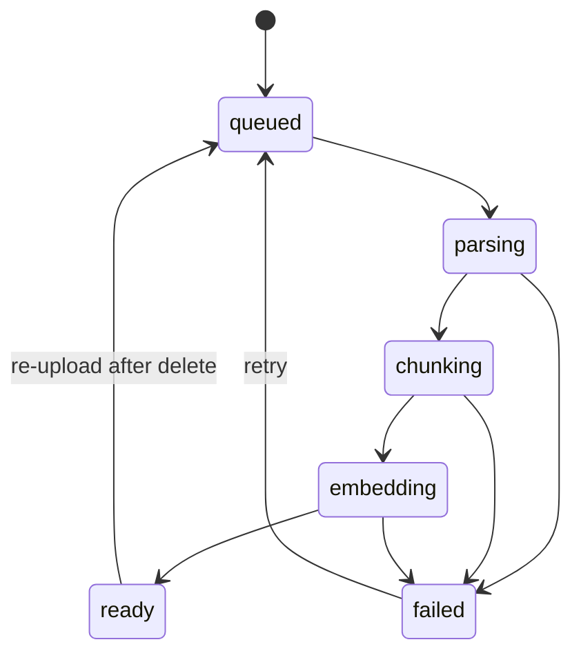

# Spec: Ingestion pipeline

Status: implemented Milestone: M1

## Problem and goal

An uploaded document is just bytes in a bucket. Turning it into something
answerable takes parsing, chunking and embedding — work that is slow, costs
money, and fails in ways worth recovering from. It cannot happen inside the
upload request.

The goal is a background pipeline that is **observable** while it runs,
**recoverable** when it fails, and **idempotent** when it is run again.

## Behaviour

Each document moves through states, and the state is always visible:

Alongside the state, a `progress` percentage advances, so a user watching an
upload sees movement rather than a spinner that might be stuck.

A transient failure — a provider timeout, a rate limit — is retried
automatically with exponential backoff. After the attempts are exhausted the
document lands in `failed` with a readable reason, and a human can retry it.

Re-running a document **replaces** its chunks rather than adding to them.

## Where the work runs

BullMQ on Redis holds the queue. `WORKER_MODE` decides where the processors run:
`inline` in the API process, `separate` as its own process, `off` not at all.
Redis is the source of truth for retries and attempt counts; `documents.status`
and `documents.progress` are the durable, user-facing projection of that,
because a user looking at a document should not need the queue to answer "what
happened to this".

## Acceptance criteria

**AC1.** Given a queued document, when the processor runs, then it ends `ready`
with chunks stored and `chunkCount` matching the number of chunk rows.

**AC2.** Given a document being processed, when each stage begins, then the
document's status reflects the stage and `progress` increases monotonically.

**AC3.** Given a document that reaches `ready`, when it is inspected, then
`progress` is 100 and `error` is null.

**AC4.** Given a PDF, when it is processed, then `pageCount` is recorded and
chunks carry page numbers.

**AC5.** Given embedding fails transiently, when the job runs, then it is
retried up to `attempts` times with increasing delay.

**AC6.** Given embedding fails on every attempt, when the attempts are
exhausted, then the document ends `failed` with a readable `error`, and no
partial chunks remain.

**AC7.** Given a document that failed, when it is retried, then it is
reprocessed and can reach `ready`.

**AC8.** Given a document that is already `ready`, when it is processed again,
then its old chunks are replaced, not duplicated, and `chunkCount` stays
correct.

**AC9.** Given a chunk replacement, when it happens, then the delete and the
insert are one transaction, so a crash mid-way cannot leave a document `ready`
with half its chunks.

**AC10.** Given a document whose text extracts to nothing, when it is processed,
then it ends `failed` saying no text could be extracted, rather than `ready`
with zero chunks.

**AC11.** Given a corrupt PDF, when it is processed, then it ends `failed` with
a readable reason and the error is logged in full.

**AC12.** Given chunks to embed, when they are embedded, then they are sent in
batches rather than one request per chunk.

**AC13.** Given an embedding call completes, when usage is recorded, then a row
in `llm_usage` captures the model, token count and cost.

**AC14.** Given a document in English and one in Portuguese, when they are
processed, then each records its detected language, because full-text search
needs the right stemmer.

**AC15.** Given a worker is killed mid-job, when it restarts, then the job is
picked up again rather than being lost.

**AC16.** Given `WORKER_MODE=off`, when a document is uploaded, then it stays
`queued` and nothing processes it.

## Edge cases and failure modes

- **A document deleted while it is being processed.** The processor checks the
  document still exists before writing chunks, and exits quietly if not.
- **Chunks embedded, then the database write fails.** The job retries; because
  the write is a replace-in-one-transaction, the retry is safe. The embedding
  spend is lost, which is the accepted cost of not holding a transaction open
  across a network call to a model provider.
- **A provider rate limit.** Surfaces as a retryable error; backoff is what
  resolves it.
- **An enormous document.** Chunking is linear and streaming is not implemented;
  a very large file will hold memory. `MAX_UPLOAD_MB` is the current guard.

## Non-goals

- Partial or incremental re-ingestion of a changed document.
- Priority queues or fair scheduling between users.
- Re-embedding everything when the embedding model changes. That is a real
  migration and is written up in `docs/rag-pipeline.md` as future work.

## Test plan

| AC            | Level              | File                                               |
| ------------- | ------------------ | -------------------------------------------------- |
| AC1–AC4, AC14 | integration        | `apps/api/test/integration/ingestion.spec.ts`      |
| AC5–AC7, AC15 | integration        | `apps/api/test/integration/ingestion.spec.ts`      |
| AC8, AC9      | integration        | `apps/api/test/integration/ingestion.spec.ts`      |
| AC10, AC11    | unit + integration | `apps/api/src/ingestion/**/*.spec.ts`              |
| AC12, AC13    | unit               | `apps/api/src/ingestion/embedder/embedder.spec.ts` |
| AC16          | unit               | `apps/api/src/ingestion/ingestion.module.spec.ts`  |

## Open questions

`attempts = 3` with exponential backoff from one second is a starting point. If
the eval runs in M7 show provider rate limits dominating, the backoff is the
first thing to tune.
