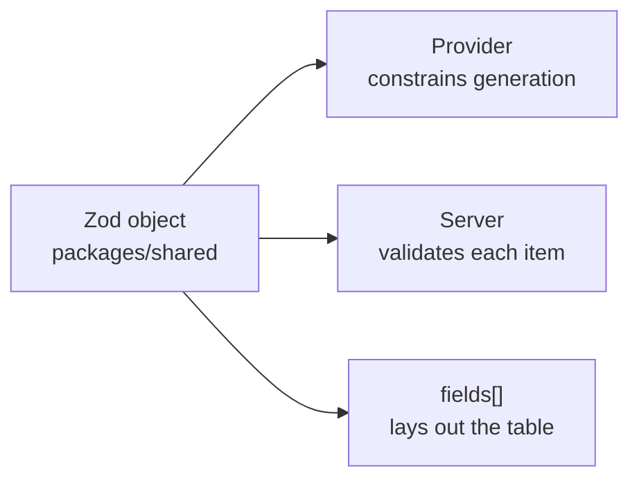
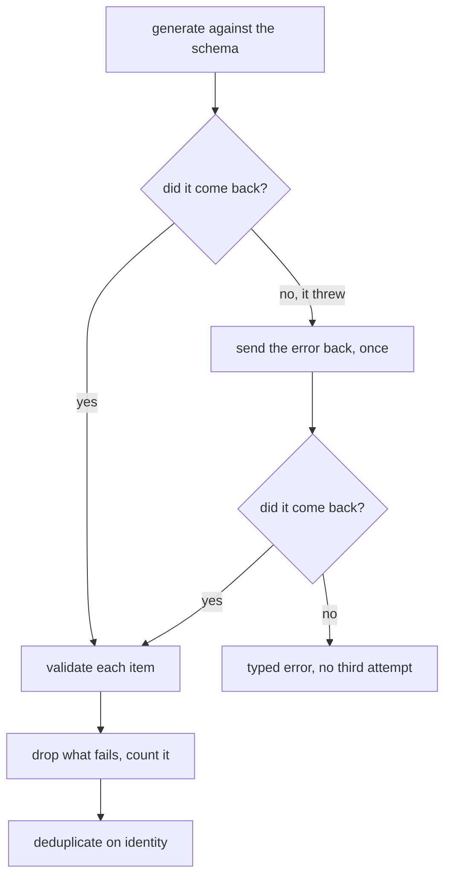

# Structured output

Getting JSON out of a language model that matches a schema, and what to do when
it does not.

## Why not parse the prose

The obvious way to get a list of endpoints is to ask for one and parse the
answer. I have done it and it fails in a way that is hard to see: the model
returns something that parses perfectly and is subtly wrong — a field renamed, a
boolean as the string `"true"`, three endpoints where the prose described four.
Parsing succeeds, so nothing raises, and the error arrives downstream wearing
the costume of real data.

Constraining the output removes the parsing step and replaces it with a
validation step, which is the one I want: either the object is the shape I
declared or I know precisely which field is not.

| Approach               | Fails as                      | Caught by        |
| ---------------------- | ----------------------------- | ---------------- |
| Ask for JSON, parse it | Valid JSON of the wrong shape | Nothing, usually |
| Constrain and validate | A named field failing a rule  | The validator    |

## One definition, three readers

A schema here is one Zod object in `packages/shared`, and three different things
read it:



The provider is given it as a JSON Schema and generates against it. The server
parses every item through it before letting it out. The web app renders a column
per field — not from a list of columns it holds, but from `fields` on the
`GET /extract/schemas` response, so a schema added on the server shows up in the
interface with no front-end release.

Having one definition is the point. Two would drift, and the drift would show as
a column rendering `—` for a field the model filled in perfectly.

## The registry

The caller names a schema; the server holds the definitions. A caller-supplied
schema would be a caller-supplied contract — nothing downstream could rely on
it, and it would turn the endpoint into a way to ask the server for arbitrary
shapes.

| Name               | What it extracts                                        |
| ------------------ | ------------------------------------------------------- |
| `api_endpoints`    | Method, path, summary, whether it needs a token         |
| `document_outline` | The headings, with their level and a one-line gist      |
| `faq_pairs`        | Question-and-answer pairs the documents already contain |

An entry is five things: the Zod object, a title and description, a default
query to retrieve with, the `fields` a table needs, and an `identity` function.

```ts
export const SCHEMA_REGISTRY = {
  api_endpoints: {
    title: 'API endpoints',
    description:
      'Every HTTP endpoint the documents describe, with its method, path, a ' +
      'one-line summary, and whether it needs authentication.',
    defaultQuery: 'HTTP endpoints, methods, paths, authentication',
    item: apiEndpointSchema,
    fields: [
      { name: 'method', kind: 'enum', label: 'Method', options: ['GET', 'POST', …] },
      { name: 'path', kind: 'string', label: 'Path' },
      …
    ],
    identity: (item) => `${item.method} ${item.path}`,
  },
  …
} as const;
```

**Adding one** is a change to that object and nothing else: the endpoint, the
validation, the chooser and the table all read from it. The one thing worth
spending time on is `description`, because it becomes the instruction the model
is given, and `identity`, because it is what deduplication means for that shape.

### Why `identity` and not deep equality

The same endpoint is often described in two retrieved passages, and the model
emits it twice with the summaries worded differently. Deep equality would keep
both. `identity` says what makes two items the same item — for an endpoint, the
method and the path — and the second one is dropped.

## Retrieval first

Extraction runs over retrieved passages, not over the corpus. Extracting from
everything would be a summarisation problem wearing a different hat, and would
cost accordingly — the whole corpus in the context window, every time.

So `prepare()` retrieves `EXTRACT_TOP_K` passages using the schema's
`defaultQuery` (or the caller's `query`, or one document if given a
`documentId`), and those passages are the context. Both endpoints share
`prepare()`, so the streaming one cannot drift from the one-shot one on which
names it accepts or what it reads.

The consequence worth stating plainly: **an extraction is only as complete as
the retrieval that fed it.** Twelve passages of a forty-passage corpus will miss
endpoints. The citations come back with the result so that is visible rather
than implied.

## Validation, and the single repair



Two layers, because they catch different things:

**The provider's own constraint** throws when the whole response does not fit
the array schema. This is the layer that surprised me — `Output.array` does not
hand back a partly-valid array for me to filter; it throws, and the items never
reach my validation at all. So the throw is caught and turned into the repair.

**Per-item validation** then runs on what did come back, because an array can
satisfy "array of objects" while one element inside it fails a field rule. Items
that fail are dropped and counted, never silently discarded — `dropped` is in
the response and on the screen, because a dropped item is data the reader asked
for and did not get.

### Why repair rather than retry

A model asked the same question twice gives the same answer twice. Asked again
_with the validation error_, it usually corrects the field. So the second
attempt carries the error text into the instructions:

> Your previous answer did not match the required shape. The problem was:
> `<the validator's own message>`. Produce the same information again,
> corrected.

**Once, not twice.** One repair costs a single extra call and catches the common
case. A second doubles the worst-case cost to catch a case I have not seen. A
second failure is a typed error — `ExtractionFailedError` — not a third attempt,
and it says what the last error was so the schema can be reworded.

Both attempts' tokens are recorded, including the attempt that failed. A call
that failed part-way still cost what it cost, and a `repaired` count climbing in
the usage ledger is the signal that a schema needs attention.

## Streaming completed items

`POST /extract/stream` sends one event per finished item:

```
data: {"type":"schema","schema":"api_endpoints","citations":[…]}

data: {"type":"item","item":{"method":"POST","path":"/auth/token",…}}

data: {"type":"done","dropped":0}

data: [DONE]
```

This uses `elementStream` rather than `partialObjectStream`. The difference
matters: `partialObjectStream` yields the object as it grows, so a row would
appear with `method` filled and `path` still empty. A half-arrived row is
indistinguishable on screen from a row the model could not fill, and showing one
is worse than showing nothing yet. `elementStream` yields array elements only
once they are complete.

**No repair on the streaming path.** A repair means discarding what was already
sent and starting over, and a table that empties itself and refills is worse
than one that says it ended early. If the stream breaks, what arrived stands and
an `error` event says so.

A hand-rolled event shape rather than the AI SDK's UI message stream: this is
not a chat, there is no message to assemble, and a client should not have to
understand a protocol built for conversation to read a list of rows.

### Reading it on the client

`fetch` with a reader, not `EventSource` — `EventSource` is GET-only, and
putting the schema and the reader's query into a URL would put their query text
into every access log between here and there.

Two details that are bugs when missed, and silent when they are:

- `TextDecoder` is used with `{ stream: true }`, because a multi-byte character
  can be split across two reads. Decoding each read alone turns the `ã` in
  _visão_ into a replacement character.
- The buffer keeps whatever is left after the last `\n\n`, because a frame can
  arrive in two pieces. Parsing each read independently loses the event that
  straddles the boundary.

Both have a test that fails if the handling is removed.

## The table

Rows are appended, never replaced or reordered, which is why keying them by
position is safe. It also means a row that has arrived keeps its DOM node when
the next one arrives — a remount would reset scroll and drop focus mid-stream,
so there is a browser test that marks the first row's element and checks the
mark survives two more rows landing.

Values are rendered through a helper rather than `String()`. A field the schema
says is a string can arrive as an object, and `String({})` puts
`[object Object]` in a cell — a rendering bug wearing a value's clothes.
Anything that is not a primitive is shown as JSON instead, which is ugly and
honest.

The download is the items plus the schema name and the citations, not a bare
array. A file that has lost its provenance is a file nobody downstream can
check, and provenance is the one thing every answer here carries.

## What this costs

Structured extraction is a single generation over retrieved passages, so it
costs roughly what one chat answer costs — plus one more generation on the
repair path. Both are in the usage ledger under `operation: 'structured'`, so
the real number is `docs/costs.md`'s to report rather than this page's to guess.

## Without a provider key

With `LLM_PROVIDER=mock` the extraction returns one obviously canned row that
says so in its own text — the path is exercised end to end, and nobody can
mistake the output for a real extraction.

## See also

- [Spec: structured extraction](./specs/structured-extraction.md) — the
  acceptance criteria and where each is tested.
- [The agent and its tools](./agent-and-tools.md) — `extract_structured` is the
  same registry reached by a model that decided to use it.
- [The RAG pipeline](./rag-pipeline.md) — the retrieval that feeds extraction.
